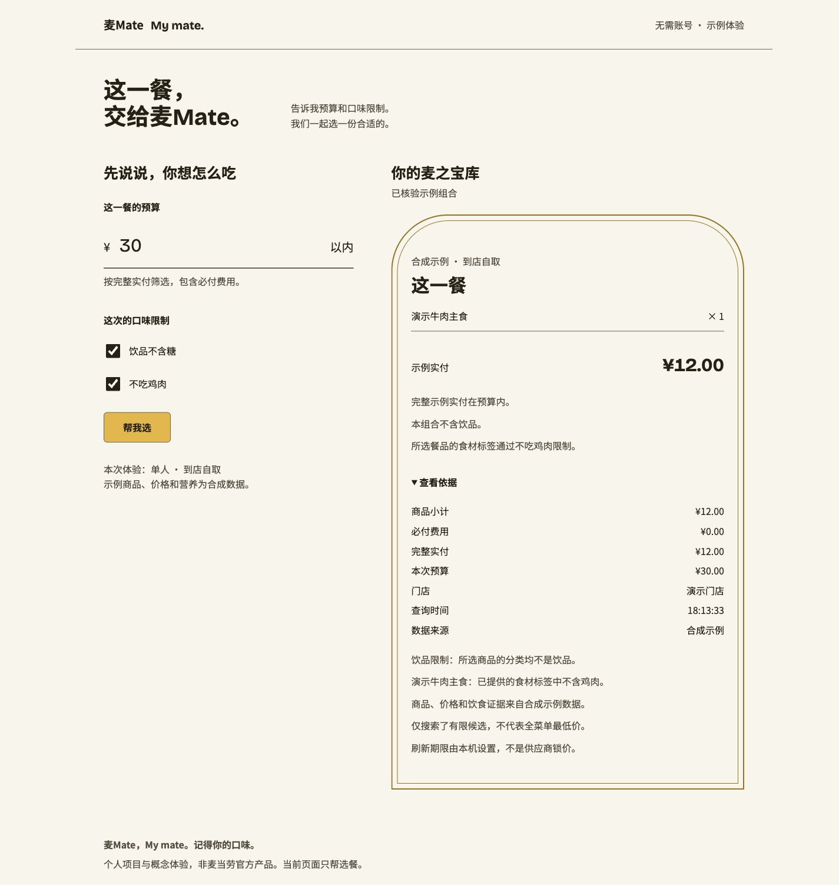

# 麦之宝库：互动配餐示例

受众：想快点选好一餐的人。用途：按本餐预算和两项限制，选一个组合。调性：playful。

```sh
cd runtime
npm ci
npm run web
```

打开终端显示的 `http://127.0.0.1:8787`。Node.js 需要 24.21.0 或更新。构建后也可以 `npm run build && npm run web:build`。

网页与 CLI、MCP 共用推荐 Runtime。输入元金额，精确转整数分；饮品不含糖、排除鸡肉均走硬约束。单人、立即到店自取，可能只推荐主食。示例商品和价格明确标为合成数据；不代表实际菜单最低价。修改条件立即标记旧结果；本机报价刷新窗口到期后要求重新查询。展开“查看依据”可看费用、优惠与来源，以及每件餐品的饮食证据：不含饮品单独说明；含饮品时区分饮食元数据与每份糖零克的营养数据；排除鸡肉展示具体食材标签依据。缺少依据不输出合格结果。

网页使用临时 SQLite、未验证的用户来源，不保存长期偏好。现有 Skill 的受信任偏好记忆流程仍单独提供。服务器仅监听本机、限制同源 Host / Origin、请求大小和并发；不公开 Token，不提供交易入口。

真实接入见 [到店自取验证](official-pickup-validation.md)。真实模式缺凭据或复核配置会显示不可用，不回退示例。



[移动端实际截图](assets/interactive-demo-mobile.jpg)

## 界面验收记录

2026-10-11：浏览器检查 320 / 375 / 414 / 768 / 1440 宽度，均无横向溢出，按钮及依据标签不换行。预算修改、饮品限制（含关闭）、鸡肉排除、零预算与报价到期已实测。临时故障服务注入一次上游错误，再延迟一次响应：保留条件重试可恢复；慢响应途中改为零预算，旧结果没有覆盖新条件。键盘 Tab 从预算进入复选框显示即时 3px 焦点环，再进入按钮按 Enter 可提交；原生 details 可用 Enter 展开。

按 OKLCH 转线性 sRGB 的相对亮度计算，画布上的正文 14.68:1、辅助文字 7.44:1、边界 5.05:1、金拱 3.97:1、焦点 6.83:1。失效结果保留原有对比度，状态由文字表达。减少动效媒体查询已检查为 150ms 透明度入场、无位移；浏览器工具没有运动偏好仿真，未声称实测该系统设置。

结果状态为持久的 polite/atomic 读屏区域，成功、无合格组合和到期状态均检查 DOM 属性与文字；实际读屏设备尚未测试。截图更新后重新检查五种宽度，均无横向溢出。

前端规约逐项自检：

1. 没有渐变背景或渐变文字。
2. Bricolage Grotesque + Noto Sans SC，两款字体，swap 加载。
3. 没有全屏居中首屏、三等列、套卡或单边色条。
4. 桌面左侧表单、右侧宝库；标题与正文偏左。
5. 没有编造增长指标、证言或客户 logo；示例餐价标明合成数据。
6. 没有 emoji 图标、混用图标库或假手机/浏览器边框。
7. 颜色、字体、间距、圆角和动效走 CSS token；颜色均 OKLCH。
8. 没有 transition: all、放大卡片、回弹或满页滚动淡入；结果仅首次入场。
9. 焦点环即时；375px 无溢出；可点击文字不换行。
10. 没有重复章节编号或左标签右标题的 section head。
11. 两款字体、五档字号。
12. 页面功能描述对应实际代码；商品价格与证据均注明示例性质，未宣称真实账号通过。
