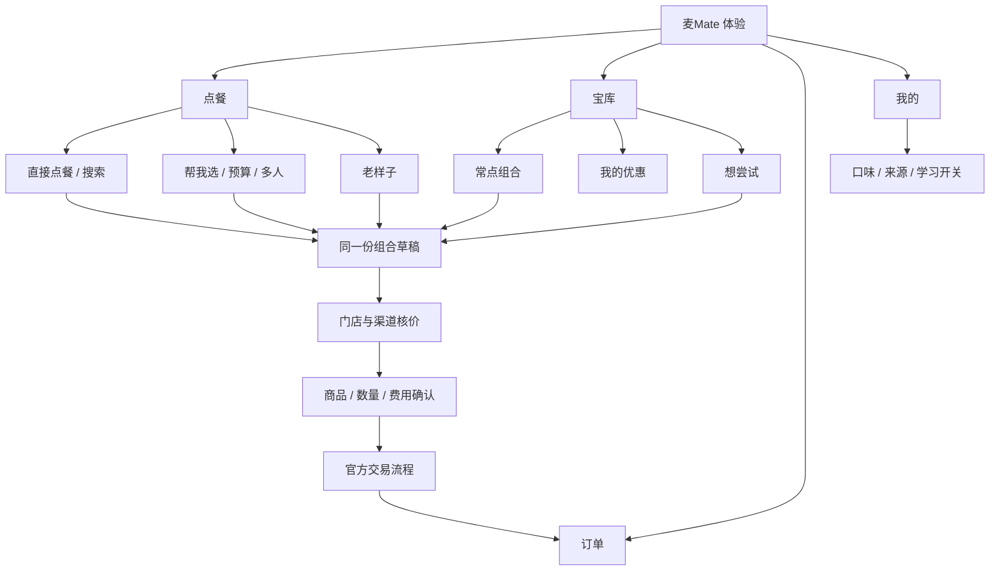
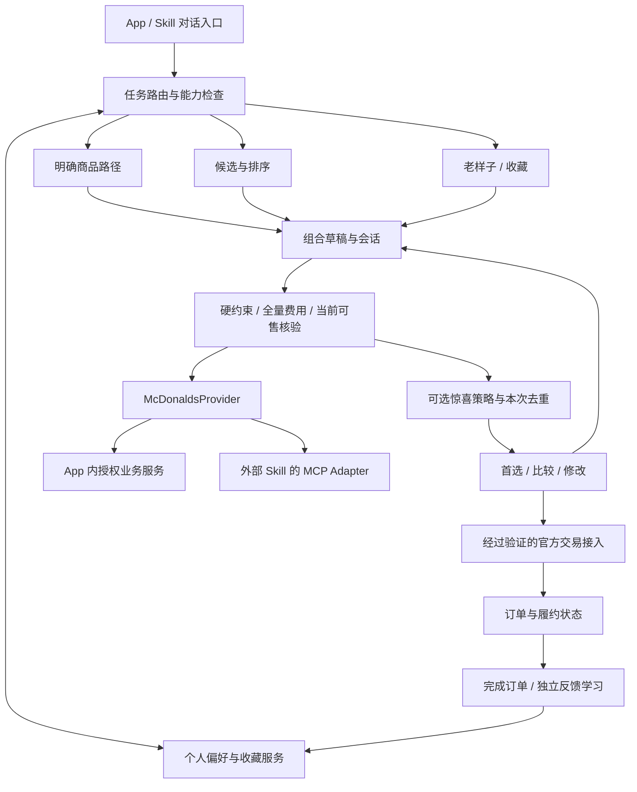

# 麦Mate / MyMate · 产品架构 v0.2

> 麦Mate，My mate。你的麦之宝库，记得你的口味。

日期：2026-10-11。本文是目标产品架构；实现状态见第 11 节。面向麦当劳 App 内的点餐体验设计，不代表官方现有界面。用户场景是待验证的设计假设，没有声称已覆盖某个比例的真实用户。

## 1. 产品目标与选择

受众：独自点餐、熟客复购、预算敏感、多人代点，以及希望轻松尝新的用户。用途：选定并完成适合当下的一餐。调性：playful。

将“能满足大部分用户”落实为覆盖常见任务，而非要求所有人都采用对话点餐。用户知道吃什么时直接点；不确定时交给麦Mate；有熟悉组合时叫回老样子。三条路径共享商品、购物车、报价和订单状态，随时可以切换。

考虑过三个方向：全对话入口表达灵活，但明确目标用户要额外描述；纯宝库陈列便于发现，但容易增加挑选负担；多入口共用决策与交易流程能兼顾两者，本稿选择第三种。

基础满足来自正确、可控和顺利取餐。惊喜来自一次恰当的发现、被记住的口味、重新出现的熟悉组合。动画只负责表达这些价值。

## 2. 常见使用场景

| 当下任务 | 默认入口 | 必要交互 | 满足的依据 |
| --- | --- | --- | --- |
| 已经知道吃什么 | 直接点餐 / 搜索 | 选择规格与数量 | 保留明确商品，不擅自加套餐 |
| 不知道怎么选 | 帮我选一餐 | 场景或一个关键问题 | 一个有证据的首选，可换可改 |
| 想省一点 | 预算快捷入口 | 硬预算按完整实付核验 | 含必付费用，不用小计冒充总价 |
| 经常点同一份 | 老样子 | 重核可售、规格和价格 | 熟悉组合，变化明确告知 |
| 多人一起吃 | 多人入口 | 人数、总预算和每人必要限制 | 各自限制分开，共享部分明确 |
| 想尝新 | 给我点惊喜 | 自愿启用，可限定变化部位 | 新选择仍符合硬约束 |
| 有饮食限制 | 在任一入口表达 | 只澄清影响结果的歧义 | 证据不明不宣称适合 |
| 正赶时间 | 直接点 / 老样子 | 展示真实取餐信息（若有） | 少操作，不捏造出餐时间 |
| 新用户或不愿留记忆 | 直接点 / 本次帮选 | 无偏好问卷，按当前请求处理 | 无历史也能使用核心功能 |
| 正在等餐 | 订单 | 展示真实履约状态 | 取餐信息优先于营销和推荐 |

初版支持单人和同设备代多人点餐；多人异地协作、分账和社区不进入首发范围。对“每人预算”与“总预算”不确定时只问清这一项。

## 3. 信息架构

目标原型的底部导航：点餐、宝库、订单、我的。官方 App 集成时可映射到已有导航，不强制新增第五个 tab 或复制原有支付流程。

点餐页上方固定表达门店、渠道与当前购物车。未选择门店可以浏览“组合草稿”，但不展示已核验价格，不允许作为已确认推荐提交。已有购物车优先恢复，推荐不会静默覆盖它。

点餐页核心是一个可输入需求的区域和显著的“直接点餐”。预算、多人、换口味是短入口。老样子有历史才出现；没有历史时将空间留给开始点餐。

宝库将常点组合、持有优惠和想尝试分开。收藏是可复用配方，不意味着商品仍可售或价格被锁定；券是有资格和期限的权益；菜单是可访问资源。已失效内容保留解释与替代入口，不继续显示为可直接兑换。

订单只呈现经过供应商确认的状态、取餐方式和必要信息。我的集中管理账户、口味、学习设置和帮助，不在这里堆新品与广告。

## 4. 一餐的完整流程

### 直接点餐

保留用户指定的商品、数量及“不加饮料”等边界。先匹配唯一商品及合法规格，核价后进入同一份组合草稿。只在匹配歧义或必选规格缺失时追问。不以推荐引擎生成的“更合适套餐”替代明确订单。

### 帮我选

当前需求 → 合并有效个人偏好 → 生成有界候选 → 硬过滤 → 当前完整报价 → 排序 → 一个首选。用户要求比较时展示最多三个有区别的合格组合，不为凑数补齐。

选择解释只讲用户能核对的一个关键理由，例如预算、已知口味或有来源的营养比较。证据缺失时省略相应理由。

### 老样子

有用户主动保存的组合时优先按其选择；否则读取适用的已完成订单。一笔历史称“上次那份”。重新核验规格、门店、餐段、渠道、券及完整价格。缺货可以提出替换，用户接受前保留原稿，不把替换后的内容静默称作老样子。

### 多人

同设备建立“我 / 同行者”的临时餐位，各自指定主食、饮品限制及数量，共享配餐单独列出。多人总价必须用整体组合核验，不能简单相加多个单人券价。个体限制不泄漏给其他餐位，共享食物按实际食用者限制的交集筛选。

付款账户不等于所有人的口味来源。同行者信息默认仅用于本餐；“以后照这个来”只能保存用户明确命名的组合（若收藏能力存在），不能推断为用户本人长期喜欢所有商品，也不自动给同行者建立永久画像。

### 确认、取餐、餐后

组合页面允许换主食、换配餐、改数量，所有修改使旧报价失效。显示完整应付、已用优惠、门店、渠道及实际支持的取餐时间，再进入官方交易流程。优惠、积分、订单提交是不同动作；确认选餐不等于授权消耗积分或付款。

提交超时先查询订单状态；状态不明不盲目重试。只有具有可靠幂等机制的集成才启用自动提交。未接通下单时准确说明当前只是选餐。

完成订单后可提供轻量的“下次还想吃 / 想换一换”，不用每餐问卷打断。评价可撤回；“不合适”要区分口味、份量、履约问题，不能全部变成永久禁推。

## 5. 惊喜机制

惊喜是用户可控的探索策略。默认不提高预算、不突破饮食限制、不消耗积分、不领取或购买额外权益，不以随机抽奖替代选择。

| 时机 | 可提供的惊喜 | 生效前提 |
| --- | --- | --- |
| 用户主动说换口味 | 同等约束下换一个不同主食或配餐 | 候选真实可售，有完整报价 |
| 熟悉组合不可用 | 一个解释清楚的接近替代 | 明示改变，用户选择后替换 |
| 已有券可用于本餐 | 当前券能使本餐更划算 | 同一范围的完整报价可比较 |
| 用户主动浏览宝库 | 符合其口味的新选择 | 未尝试不等于喜爱，不伪造稀缺性 |
| 用户愿意留下一份组合 | 下次快速找到自己的命名组合 | 收藏写入成功，配方有来源 |

“不加钱换一种”必须满足：新旧报价同一用户、门店、渠道、履约时点和费用口径，均有效，且替换后的完整实付不高于原稿。预算 30 元不意味着可以把用户选定的 20 元组合默认升级到 29 元。用户仅说“给我惊喜”时默认保持当前已选方案的实付上限；若尚无基准，沿用明确硬预算。用户在本次请求主动给出“三十以内”等明确预算时，按该上限探索，不重复索要加价许可；若同时要求“不加钱”，仍不能超过原实付。

本次已展示、已拒绝的组合要通过商品、规格、数量构成的标准化签名去重；换券、改显示顺序或改名称不算新组合。候选用尽时说明，没有无限刷新。没有去重接口时可在实际返回的合格候选中筛选，不能给工具虚构参数。

关闭探索后只使用直接点、熟悉组合和当前偏好。商业活动只能在合格集合中成为可见、可解释的次级信息，不能改变硬约束和完整价格。

## 6. 记忆与宝库数据

| 对象 | 含义与寿命 | 来源与控制 |
| --- | --- | --- |
| MealSession | 当前人数、餐位、草稿、已展示组合、拒绝原因 | 临时会话；明确清除或超时失效 |
| Preference | 用户长期声明与可区分的行为推断 | 来源、范围、有效期；可改、可忘、可暂停 |
| SavedMeal | 主动收藏的命名配方及规格 | 不保存“永远有效”的价格与券；每次重新核验 |
| WishItem | 想尝试的商品或组合 | 用户主动保存，不自动当作已吃过 |
| EntitlementView | 优惠券等账号权益的当前视图 | 上游为真相来源；资格与期限变化立即失效 |
| QuoteEvidence | 完整报价、费用、适用范围、期限 | 绑定组合与范围；草稿变化即失效 |
| Order / Feedback | 已确认订单与独立的餐后感受 | 接受推荐不构成已完成订单 |

优先级：安全限制 → 本餐明确约束 → 明确长期偏好 → 有来源的行为推断 → 探索。普通口味可以本次例外，安全限制不能由随手点选自动解除。

明确记住需要成功的持久写入。无可信宿主来源时只在当前会话执行，不说“已经记住”。清空、暂停和删除的范围保持可见；本地记忆删除不伪装成供应商交易记录删除。

## 7. 麦之宝库视觉体系

视觉意象是“许多小门里放着可取用的一餐”。首页几扇错落的细金拱门表现丰富；宝库里的双拱框定个人组合；选中后的一扇门聚焦这一餐。门是食物与选择的容器，不承担金额、禁忌和错误信息的表达。

每个界面有不同重心：点餐重入口，宝库重可复用资源，这一餐重食物与确认。菜单使用易扫读的商品列表，不把每个商品塞进金框。订单、错误和付款页保持功能性。

调性 playful。背景为暖纸色，深棕文字，金色作为锚色相 85 的少量强调。食物素材本身可以保留真实颜色；UI 颜色全部来自 token。强调色目标占视口不超过 3%，无彩色光晕、渐变标题、宫殿背景、盲盒等级或稀有度标签。

字体：Bricolage Grotesque（Latin display）与 Noto Sans SC（中文及正文）。中文标题字重 700，正文 400。字号采用 1.25 比例，以 16、20、25、31.25、39.06 为五档；小屏允许减少可见档位，不把正文缩到 14 以下。

建议设计 token（是实现输入，实际界面须测量对比度）：

| 语义 | 初值 |
| --- | --- |
| canvas | oklch(97% .012 85) |
| surface | oklch(94% .015 85) |
| ink | oklch(25% .025 85) |
| ink-muted | oklch(43% .025 85) |
| control-border / focus | oklch(52% .025 85) |
| accent | oklch(80% .15 85)，搭配深色 ink |
| dark canvas / surface / ink | oklch(15% .012 85) / oklch(20% .015 85) / oklch(94% .015 85) |
| space | 4 / 8 / 12 / 16 / 24 / 32 / 48，按语义使用 |
| motion | 120 / 220 / 420ms；cubic-bezier(.16,1,.3,1) |

一餐首次出现可做一次不超过 500ms 的编排，只移动 transform 与 opacity。减少动态效果时改为 150ms 透明度变化；复购与赶时间可以直接展示。没有抽卡必看动画，没有靠多消费升级宝库的机制。

触屏命中区域按平台设置（iOS 至少 44pt、Android 至少 48dp），有可读标签。焦点环即时出现。正文对比度至少 4.5:1，控制边界至少 3:1。适配 320、375、414、768、1440 宽度，最大系统字号和屏幕阅读器；拖动换餐必须同时有按钮替代。概念图不能代替这些实现验收。

## 8. 运行架构

保持模块化单体，暂不拆微服务。App 内集成与外部 Skill 共用领域接口，使用各自宿主的账户和授权机制；不将外部 Bearer Token 作为 App 原生账户架构的默认方案。

语言模型负责表达理解、必要澄清和证据解释；金额、有效期、硬约束、规格、去重签名、写入授权及订单状态由确定性组件核验。直接点餐不依赖语言模型才能继续。

拟新增的领域操作包括：browseMenu、quoteExactBasket、createMealSession、replaceItems、listSavedMeals、saveMeal、listEntitlements、suggestAlternative。它们是未来领域接口名称，不是当前可调用 MCP 工具。交付 Skill 必须发现实际工具与 schema，再选择可执行路径。

## 9. 异常与降级

| 情况 | 处理 |
| --- | --- |
| 无历史 | 直接开始选餐，不输出虚构老样子 |
| 无账号或定位授权 | 手选门店、当前会话；权益与历史按实际授权可用 |
| 报价缺少费用 | 维持草稿状态，提示补齐范围；不能称预算合格 |
| 当前门店缺货 | 保留草稿，展示经过核验的替代或手动修改 |
| 优惠核验失败 | 区分暂时失败与确实无可用券 |
| 无满足限制的组合 | 不放宽限制，说明具体冲突，由用户决定修改 |
| 更换门店、渠道、规格或地址 | 旧报价与优惠适用性失效，重新查询 |
| 无营养 / 配料证据 | 不宣称高蛋白、低糖或适合过敏者 |
| 推荐暂不可用 | 保留直接点餐入口；不能伪装为推荐已成功 |
| 订单提交状态不明 | 查询现有交易状态，不盲目重试 |
| 无持久收藏或记忆能力 | 本轮保留并解释范围，不能以文案假装入库 |

## 10. 验证是否满足用户

使用可观察任务与反馈验证，尚无真实用户结论。分开记录直接点餐、代选、复购和多人，避免只优化某一类。

- 决策完成：从开始选餐到明确选定组合的时间、轮数、退出位置。
- 交易完成：核价后是否顺利进入交易及完成履约；接受推荐不计作完成订单。
- 选择质量：首选接受、修改原因、餐后明确反馈；没有反馈记为未知。
- 惊喜价值：主动启用后保留替换的比例、撤回原因、后续是否自愿再选。
- 控制感：是否能找到直接点餐、返回原稿、看清总价、关闭探索与删除记忆。
- 基础正确性：超预算展示、错误饮食声明、重复提交、旧价复用等异常逐条追踪。

上线前用新用户、熟客、明确商品、预算、多人、饮食限制、弱网、无历史、大字号场景做任务测试。比较“开门效果 / 静态结果”是否增加等待或妨碍操作，不预设动画一定提高满意度。

## 11. 实现状态与发布顺序

现有 mcmate Runtime 已有：合成数据演示、有限推荐、完整报价校验、偏好管理、完成订单学习和老样子；默认 stdio 只读，可信宿主可写。真实 MCP Adapter 基础存在，真实账号映射尚未验证；没有下单付款、收藏、完整菜单浏览工具或跨轮排除接口。

首发可安装 Skill：场景路由、事实与报价边界、当前会话多人分组、受控惊喜选择、偏好规则、能力发现、可复用视觉指导；配套现有 Runtime 演示。在原生 MCP 模式下，只执行实际发现且验证支持的操作；工具缺失时准确降级。

真实产品第一阶段：完成当前门店与渠道映射，直接选商品、代选、老样子共用草稿和核价，接通经过核验的官方交易交接。未通过真实数据验收不能作为真实点餐产品发布。

第二阶段：个人收藏、参与者临时餐位、服务端会话去重、替换比较、餐后反馈、关闭探索。

第三阶段：基于真实使用验证改进探索强度与宝库陈列；仅在用户主动需要时再评估故事记忆。积分消费、多人协作和付款自动化分别经过能力与授权验收。

## 12. 外部依据与自检

官方公开平台列出点餐、活动日历、优惠券等能力，但平台描述不等于本项目账号已获授权、参数映射已验证或实时调用成功：[麦当劳 MCP 开放平台](https://open.mcd.cn/mcp)。

UI/UX Pro Max 本地检索匹配餐饮产品，但给出的落地页结构与部分默认色值不适用于此处。仅采纳可扫描菜单、食物图像和清晰操作等方向；布局、配色和触屏约束按用户规约重定。

概念检查：已覆盖三类选餐路径与履约；惊喜明确可跳过；草稿和核价状态分开；同行者不污染本人记忆；收藏、菜单和权益语义分开；无伪造价格和用户指标。效果图是视觉示意，生成的装饰细节、字体与颜色仍需在真实 UI 中按 token、对比度和可达性标准重建。
